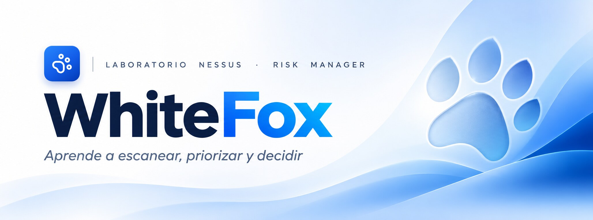

<p align="center">
  <b>Un escáner de vulnerabilidades al estilo de Nessus Essentials Plus para aprender desde cero: una red de 9 equipos con fallos reales, un manual con imágenes, recorridos guiados sobre la pantalla real, 32 ejercicios que se corrigen solos y las preguntas que te harán en la entrevista. Un solo HTML, sin servidor, sin cuenta y sin una sola petición a Internet.</b>
</p>

<p align="center">
  <a href="index.html"></a>
</p>

<p align="center">
  
  
  
  
  
  
  
  
  
  
  
  
</p>

<p align="center">
  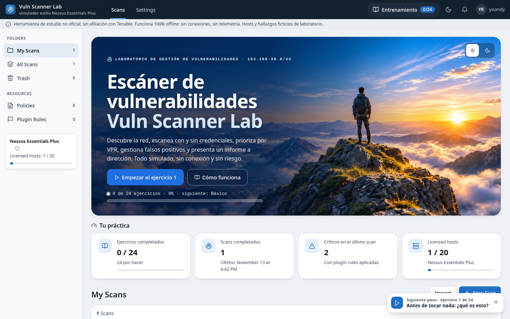
</p>

En una entrevista para gestión de riesgos te preguntarán por Nessus, por CVSS y VPR, y por cómo decides qué se parchea primero. Leer la documentación ayuda a saberlo, pero no a hacerlo: crear un scan, entender por qué no ve nada sin credenciales, distinguir un falso positivo o explicar a dirección qué está en riesgo. **WhiteFox te da la herramienta y la práctica:**

- una **red ficticia de 9 equipos** con fallos conocidos (MS17-010, Zerologon, Log4Shell, Kerberoasting, una API de IA abierta, malware en un puesto) y también ruido, falsos positivos y riesgos que se aceptan;
- la **consola de Nessus Essentials Plus 10.x** con sus nombres en inglés: las 11 plantillas, credenciales, filtros, VPR Top Threats, Remediations, Plugin Rules, informes y exportaciones;
- **32 ejercicios en 7 módulos** que empiezan por «¿qué es un escáner?», se comprueban solos mientras trabajas y terminan con un caso de una semana completa;
- un **manual de 12 capítulos** con la imagen numerada de cada pantalla y **6 recorridos guiados** que te señalan el botón real y avanzan cuando lo pulsas;
- una **bienvenida**, un recuadro de **siguiente paso** y botones de ayuda en cada término, para quien no lo ha abierto nunca;
- **12 preguntas de entrevista** de Risk Manager con su respuesta modelo.

<div align="center">

## `$ cat whitefox.yaml`

<table>
  <thead>
    <tr>
      <th colspan="2" align="left"><code>whitefox:~$ cat whitefox.yaml</code></th>
    </tr>
  </thead>
  <tbody>
    <tr>
      <td width="50%" valign="top"><code>├─ ⚑ contenido:</code><br><br>
        
        
        
        <br>
        <sub><code>7 módulos · 6 recorridos guiados · glosario de 20 términos · 12 preguntas de entrevista · CVE reales · plugins 900000+ inventados para el lab</code></sub>
      </td>
      <td width="50%" valign="top"><code>├─ ✦ aplicacion:</code><br><br>
        
        
        
        <br>
        <sub><code>sin framework ni build · un único HTML de unos 230 KB · Web Crypto para Nessus DB · se abre con doble clic</code></sub>
      </td>
    </tr>
    <tr>
      <td valign="top"><code>├─ ◉ diseño:</code><br><br>
        
        <br>
        <sub><code>interfaz con los nombres de Nessus · claro y oscuro · escala 0,97 al pulsar · menús que crecen desde su botón · 390 px</code></sub>
      </td>
      <td valign="top"><code>├─ ⚙ ci:</code><br><br>
        
        
        <br>
        <sub><code>el e2e completo en cada push y en cada PR · capturas como artefacto si algo falla</code></sub>
      </td>
    </tr>
    <tr>
      <td valign="top"><code>├─ ◈ pruebas:</code><br><br>
        
        <br>
        <sub><code>los 32 ejercicios, los 6 recorridos y los 12 capítulos usando la app · red y consola vigiladas · claro y oscuro, 1440 y 390 px</code></sub>
      </td>
      <td valign="top"><code>╰─ ⌁ privacidad:</code><br><br>
        
        
        <br>
        <sub><code>progreso en localStorage · connect-src 'none' · informes generados en tu equipo</code></sub>
      </td>
    </tr>
  </tbody>
  <tfoot>
    <tr>
      <td colspan="2"><code>version: 2.1.0&nbsp;&nbsp;·&nbsp;&nbsp;licencia simulada: Essentials Plus (20 IPs) o Essentials (5 IPs)&nbsp;&nbsp;·&nbsp;&nbsp;red: 192.168.56.0/24 (ficticia)</code></td>
    </tr>
  </tfoot>
</table>

</div>

---

##  Novedades

### 2.2.0 · noviembre de 2026 · En inglés y mejor en el móvil

- Todo el laboratorio en inglés con el selector ES · EN: ejercicios, manual, recorridos, glosario, entrevista, notas del instructor y avisos. El cambio es inmediato, se guarda y la primera vez sigue el idioma del navegador.
- Una prueba (`npm run idioma`) recorre unas 700 pantallas en los dos idiomas y falla si con la interfaz en inglés aparece un texto en español.
- En el móvil, barra de pestañas abajo (Scans, Aprender, Práctica, Settings y Más) y una hoja «Más» que se cierra deslizando.
- El manual se lee mejor: cada paso en su tarjeta junto a la imagen. Antes el texto se partía palabra a palabra en pantallas medianas.
- Estados vacíos que explican qué pasa y qué hacer, sin desbordamientos en tableta y una interfaz más sobria: etiquetas en tipo frase, logo de un color y ninguna exclamación.

### 2.1.0 · noviembre de 2026 · WhiteFox: aprender haciendo

- **Barra superior con «?» y Ajustes**: ayuda (manual, recorridos, glosario, atajos) y ajustes del laboratorio (tema, velocidad, licencia) a un clic.
- **Se llama WhiteFox.** Nuevo nombre, nuevo logo (el icono paw-print de Lucide) y nuevo título en la portada: «WhiteFox · Aprende a escanear, priorizar y decidir». El repositorio pasa a ser `heindall92/WhiteFox` (las direcciones antiguas redirigen).
- **Manual en la barra lateral** (Aprender ▸ Manual, o la tecla `?`). Son 12 capítulos, de «La consola de un vistazo» a «Policies y programación». Cada uno trae la imagen numerada de la pantalla real, los pasos con esos mismos números, los errores típicos y un recuadro **«Qué le dirías a dirección»**. Las imágenes se generan desde la propia aplicación (`npm run manual`), así que no se quedan viejas, y se amplían con un clic.
- **Recorridos guiados.** Oscurecen la pantalla, señalan el botón real y avanzan cuando haces la acción: la consola en 60 segundos, tu primer scan, leer los resultados, credenciales, una Plugin Rule y remediar y verificar. Si te sales, te ofrecen volver. Cada ejercicio tiene **Muéstrame dónde** y **Ver en el manual**.
- **8 ejercicios nuevos** (32 en 7 módulos):
  - el servicio escondido en un puerto no estándar;
  - Audit Trail;
  - credenciales que fallan;
  - Accuracy;
  - pruebas web;
  - familias de plugins;
  - **ordenar la cola de remediación**, una pregunta de arrastrar en la que el empate entre Zerologon y MS17-010 cuenta como acierto;
  - un **caso final de una semana**, en el que solo cuenta lo que haces después de empezarlo.
- **Ruta más clara:**
  - tiempo estimado por módulo;
  - módulo técnico opcional para el perfil de riesgo;
  - «Lo que ya sabes» al terminar cada módulo;
  - la primera pista se abre sola tras dos fallos.
- **Fluidez** con los patrones de Atlas GRC y de ai-job-search-es:
  - transición entre vistas (View Transitions);
  - entrada coreografiada con un máximo de 7 bloques;
  - **esqueletos** solo mientras un scan está en marcha, que no revelan cuántos hosts faltan;
  - avisos apilados que se despliegan al pasar el ratón;
  - píldora del elemento activo en la barra lateral.
- **Portada nueva**: un zorro ártico sobre la nieve (35 KB en WebP, sin peticiones externas), con el texto sobre el cielo y el mismo contraste AA en claro y oscuro.
- **Rendimiento.** Durante un scan la vista ya no se redibuja 4 veces por segundo, solo cuando aparece un host nuevo.
- **Diseño revisado con el método [Elephant-Goldfish](https://github.com/google/elephant-goldfish-model).** Un revisor sin contexto encontró 12 problemas antes de construir; están resueltos y documentados en [`docs/designs/2.1-pedagogia.md`](docs/designs/2.1-pedagogia.md).

### 2.0.0 · noviembre de 2026 · Essentials Plus y desde cero

- **Essentials Plus.** El laboratorio simula Essentials Plus (20 IPs, informes HTML y PDF, plugins en tiempo real). En **Settings ▸ About** puedes pasar a Essentials (5 IPs, solo CSV y `.nessus`) y ver qué cambia. La licencia cuenta hosts distintos, como en Nessus: si te pasas, te lo dice y te explica cómo liberar licencias.
- **Las 11 plantillas de la 10.x.** Nuevas: Ping-Only Discovery, Credential Validation, Advanced Dynamic Scan, Malware Scan, Active Directory Starter, Find AI y Remote Monitoring and Management. Las de pago (Compliance, Web App, Attack Surface, Mobile) salen bloqueadas con la versión que las incluye.
- **Hallazgos nuevos** en la red: Kerberoasting, delegación sin restricciones y KRBTGT antigua en el controlador de dominio; una API de Ollama abierta; AnyDesk con acceso desatendido; TeamViewer; malware en el puesto de RR. HH.
- **VPR Top Threats.** Las diez amenazas con más VPR y por qué: CISA KEV, exploit público, actividad o EPSS.
- **Cierra el ciclo.** «Simular parche» en Remediations, nuevo scan y en History se ve cómo baja la barra de severidades.
- **Para quien empieza.** Bienvenida, recuadro «Siguiente paso», botones ⓘ que abren el glosario, 24 ejercicios en 5 módulos (9 nuevos) y la pestaña Entrevista.
- **Exportaciones.** Nessus DB cifrado de verdad (AES-256-GCM) y PDF con el diálogo de impresión.
- **Diseño.** Iconos de Lucide, movimiento con los criterios de Emil Kowalski y vista móvil. Se corrigen contrastes, pestañas y la barra lateral plegada, que no pasaban axe.

### 1.0.0 · noviembre de 2026

- Primera versión: 5 plantillas, red de 9 equipos, 15 ejercicios, Plugin Rules, informes HTML y CSV y exportación `.nessus`.

---

## Índice

- [Novedades](#-novedades)
- [Cómo se usa](#-cómo-se-usa)
- [Ruta de aprendizaje](#-ruta-de-aprendizaje)
- [Manual y recorridos guiados](#-manual-y-recorridos-guiados)
- [Qué reproduce de Nessus](#-qué-reproduce-de-nessus)
- [La red del laboratorio](#-la-red-del-laboratorio)
- [Capturas](#-capturas)
- [Movimiento y diseño](#-movimiento-y-diseño)
- [Privacidad y seguridad](#-privacidad-y-seguridad)
- [Pruebas](#-pruebas)
- [Limitaciones conocidas](#-limitaciones-conocidas)
- [Estructura](#-estructura)
- [Licencia](#-licencia)
- [Autor](#-autor)

##  Cómo se usa

1. Descarga `index.html` y ábrelo con doble clic en Chrome, Edge o Firefox. No necesita servidor ni conexión.
2. La primera vez se abre una bienvenida. Pulsa **Empezar el ejercicio 1**.
3. Haz lo que pide el ejercicio en el simulador. Cuando lo consigues, se marca solo; después responde el quiz.
4. Si te pierdes, mira el recuadro **Siguiente paso** (abajo a la derecha) o pulsa cualquier ⓘ.

El progreso se guarda en tu navegador. Para empezar de cero: **Settings ▸ Simulador ▸ Restablecer laboratorio**. Credenciales del laboratorio (ficticias): SSH `auditor` / `Lab2026!` · Windows `LAB\svc_nessus` / `Lab2026!`, dominio `LAB`.

##  Ruta de aprendizaje

Cada ejercicio trae el objetivo, por qué importa, los pasos y las pistas, y termina con un quiz.

| Módulo | Tiempo | Ejercicios |
|---|---|---|
| **1 · Primeros pasos** | ≈ 20 min | Qué es un escáner · Consola y licencia · Host Discovery · Límite de licencia |
| **2 · Leer los resultados** | ≈ 30 min | MS17-010 · Vista Hosts · Filtros · CVSS frente a VPR · VPR Top Threats |
| **3 · Escanear mejor** | ≈ 30 min | Credential Validation · Scan con credenciales · Lo que solo se ve con credenciales · Policies y Schedule |
| **4 · Plantillas especializadas** | ≈ 35 min | «¿Nos afecta esta CVE?» con Advanced Dynamic Scan · Active Directory Starter · Shadow IT (Find AI y RMM) · Malware Scan |
| **5 · Gestión del riesgo** | ≈ 45 min | Falso positivo · Aceptación temporal de riesgo · Remediations · **Ordena la cola** (arrastrar) · 5 IPs: qué escanear primero · Informe ejecutivo · Plan en CSV · Remediar y verificar en History |
| **6 · Configura como un profesional** *(opcional)* | ≈ 35 min | Puertos no estándar · Audit Trail · Credenciales que fallan · Accuracy · Pruebas web · Familias de plugins |
| **7 · Caso final** | ≈ 40 min | Tu primera semana: inventario, scan con credenciales, Active Directory, una excepción justificada, una remediación verificada y el informe a dirección |

Si fallas dos veces un quiz, se abre la primera pista y se te sugiere el capítulo del manual. Al terminar un módulo aparece «Lo que ya sabes».

En el mismo panel están el **Glosario** (20 términos en lenguaje llano), la **Entrevista** (12 preguntas con respuesta modelo: CVSS frente a VPR, falsos positivos, aceptación de riesgo, métricas para dirección, respuesta a una CVE en las noticias…) y una **Guía** con el ciclo de gestión de vulnerabilidades.

##  Manual y recorridos guiados

En la barra lateral, **Aprender** tiene dos entradas.

**Manual** (también con la tecla `?`). Son 12 capítulos:

1. La consola
2. Host Discovery
3. Basic Network Scan y licencia
4. Leer los resultados
5. Priorizar con CVSS, VPR, EPSS y KEV
6. Credenciales
7. Filtros
8. Plugin Rules
9. Remediations e History
10. Informes
11. Plantillas especializadas
12. Policies y programación

Cada capítulo explica para qué sirve la pantalla y trae una imagen con números sobre la interfaz real. Debajo van los pasos con esos mismos números, los errores típicos y lo que le dirías a dirección.

<p align="center">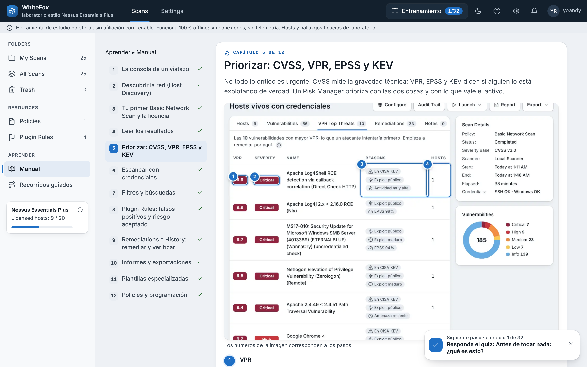</p>

**Recorridos guiados.** Oscurecen la pantalla, dejan a la vista solo el botón que toca y avanzan cuando haces la acción, no cuando pulsas «Siguiente». Hay 6 recorridos:

- la consola en 60 segundos;
- tu primer scan;
- leer los resultados;
- credenciales;
- una Plugin Rule;
- remediar y verificar.

`Esc` sale del recorrido. Si te vas a otra pantalla, te ofrece volver.

<p align="center">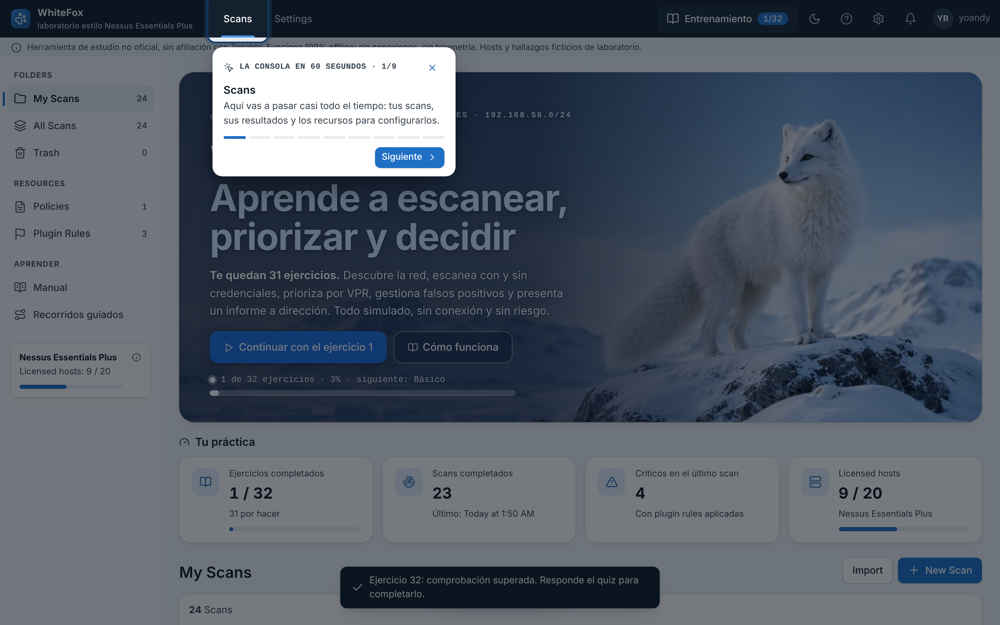</p>

##  Qué reproduce de Nessus

**Licencia** (Settings ▸ About):

| | Essentials | Essentials Plus (por defecto) |
|---|---|---|
| Hosts que se pueden escanear | 5 | 20 |
| Informes HTML y PDF | No (solo CSV y `.nessus`) | Sí |
| Actualización de plugins | Diaria | En tiempo real |

Host Discovery y Ping-Only Discovery no consumen licencia.

**Plantillas.** Discovery: Host Discovery y Ping-Only Discovery. Vulnerabilities: Basic Network Scan, Credential Validation, Advanced Scan, Advanced Dynamic Scan, Malware Scan, Credentialed Patch Audit, Active Directory Starter Scan, Find AI y Remote Monitoring and Management. Bloqueadas: Compliance, Web Application, Attack Surface Discovery y Mobile Device Scan.

**Editor.** BASIC (General, Schedule, Notifications), DISCOVERY, ASSESSMENT, REPORT y ADVANCED; Credentials (SSH y Windows, con dominio para AD); Plugins por familia en Advanced Scan; Dynamic Plugins con reglas por CVE, ID, nombre, familia o severidad y el recuento de los que coinciden.

**Resultados.** Pestañas Hosts, Vulnerabilities, VPR Top Threats, Remediations, Notes e History; detalle de plugin con Plugin Details, VPR Key Drivers, Risk Information y Reference Information; filtros Match All o Any; Audit Trail; Plugin Rules con recast, Hide this result y caducidad.

**Informes y exportación.** Executive Summary, Detailed by Host y Detailed by Plugin en HTML, PDF y CSV; exportación `.nessus`, CSV y Nessus DB cifrado.

**Lo que es solo del laboratorio** (no existe en Nessus): la nota del instructor en cada plugin, «Simular parche», los ejercicios y la ayuda.

##  La red del laboratorio

| IP | Host | Lo que vas a encontrar |
|---|---|---|
| .1 | gw (pfSense) | Certificados TLS |
| .10 | dc01, Windows Server 2019 | Zerologon; con AD Starter: Kerberoasting, delegación sin restricciones, KRBTGT antigua, AS-REP roasting |
| .20 | fs-legacy, Windows 2008 R2 | MS17-010, sistema sin soporte, TeamViewer |
| .30 | web01, Apache 2.4.49 | Path traversal; OpenSSH por banner (falso positivo por backport) |
| .40 | app01, Java | Log4Shell; API de Ollama abierta sin autenticación |
| .50 | Impresora | SNMP `public`, Telnet |
| .60 | db01, CentOS 7 | Redis sin autenticación en un puerto no estándar |
| .70 | ws-rrhh-01, Windows 10 | Parches y Chrome (solo con credenciales); AnyDesk no aprobado; malware |
| .80 | NAS Samba | Samba vfs_fruit, FTP anónimo |

Los plugins con ID 900000 o superior son inventados para el laboratorio. El resto de IDs y todos los CVE son reales; los textos y las puntuaciones son representativos.

##  Capturas

<table>
<tr>
<td width="50%">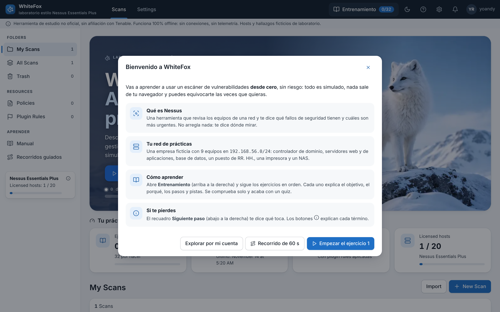<br><sub>La bienvenida, la primera vez.</sub></td>
<td width="50%">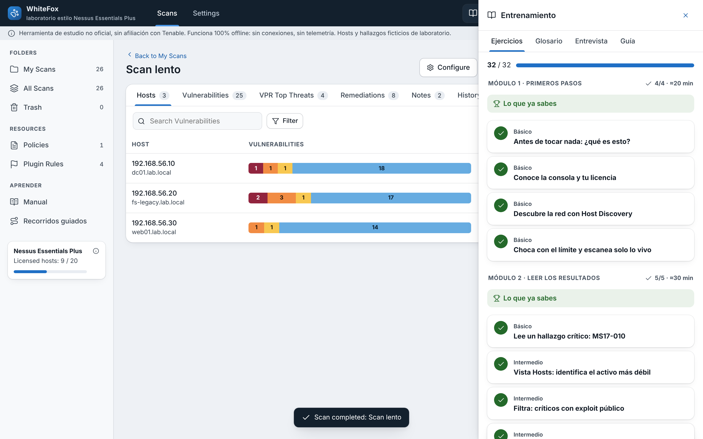<br><sub>Los ejercicios por módulos.</sub></td>
</tr>
<tr>
<td>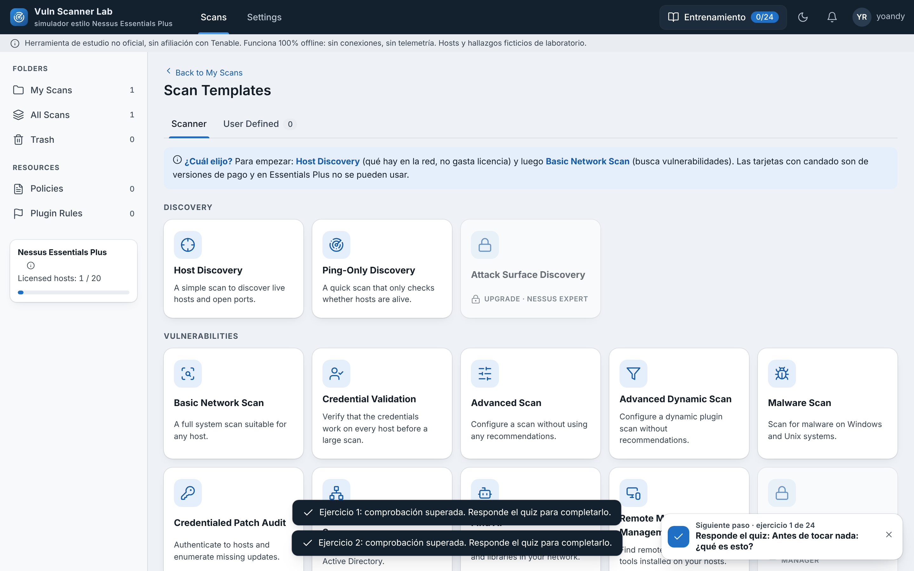<br><sub>Las 11 plantillas y las bloqueadas.</sub></td>
<td>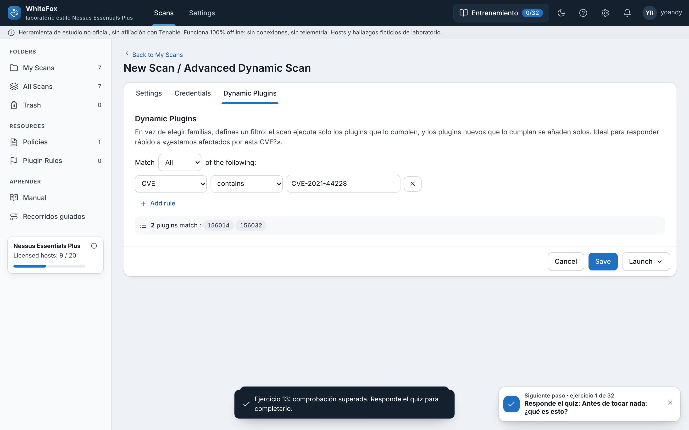<br><sub>«¿Nos afecta Log4Shell?» con un scan dinámico.</sub></td>
</tr>
<tr>
<td>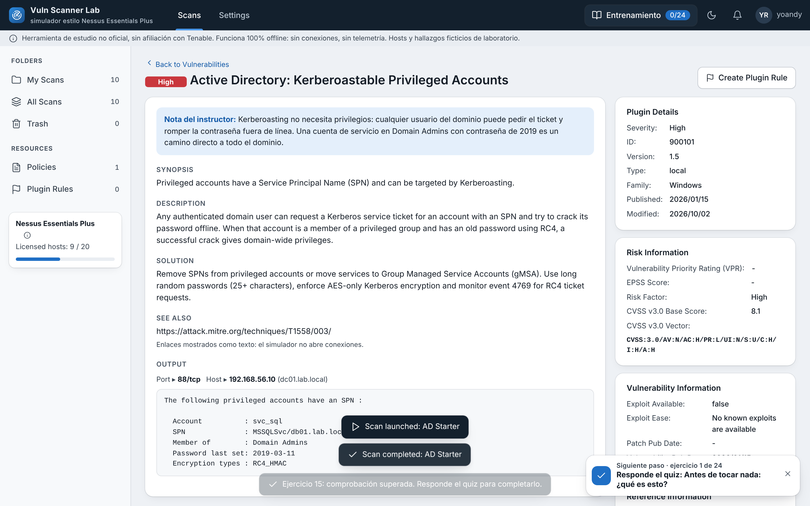<br><sub>Active Directory Starter: Kerberoasting.</sub></td>
<td>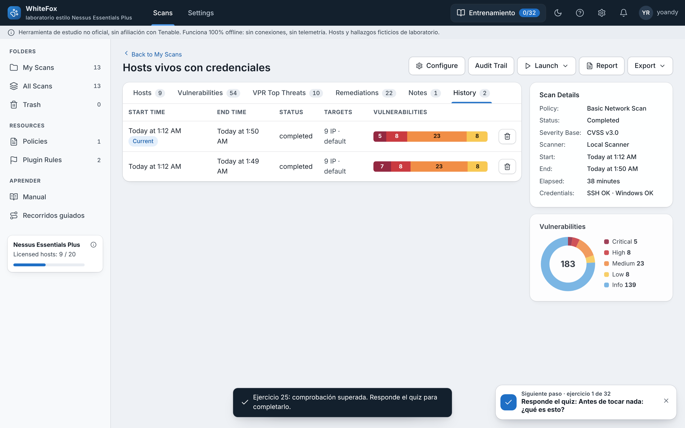<br><sub>History: antes y después de remediar.</sub></td>
</tr>
<tr>
<td>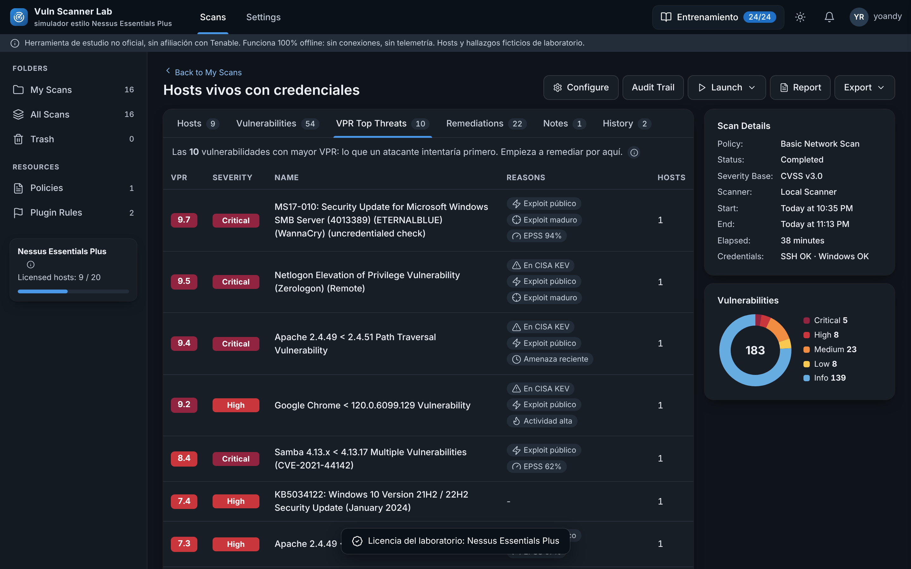<br><sub>Modo oscuro.</sub></td>
<td align="center">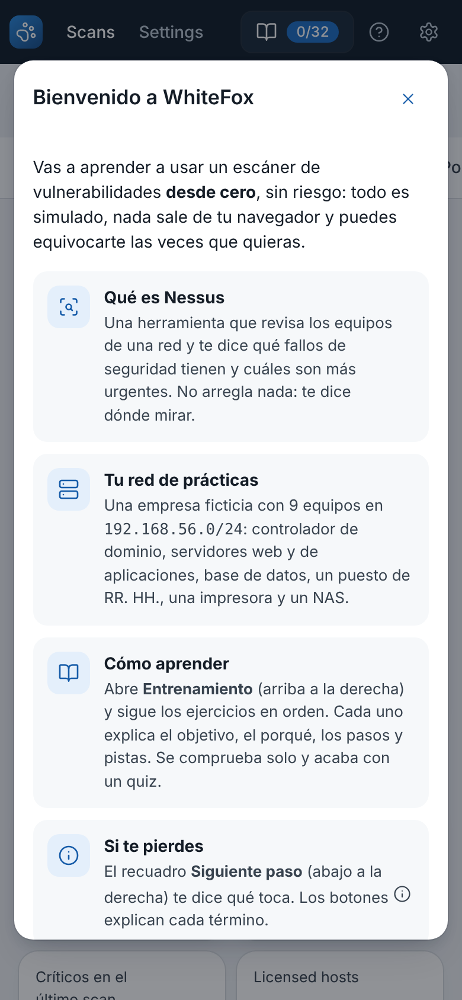 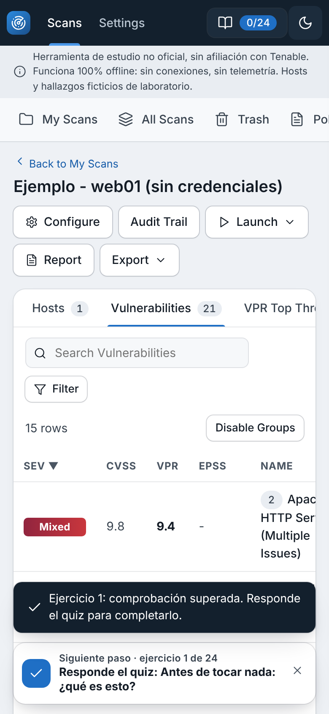<br><sub>En el móvil, a 390 px.</sub></td>
</tr>
</table>

##  Movimiento y diseño

- **Iconos de [Lucide](https://lucide.dev)** copiados en el HTML, sin CDN. Ningún logotipo de Tenable.
- **Transiciones y carga** con los patrones de Atlas GRC y ai-job-search-es: View Transitions entre vistas, entrada coreografiada (cabecera y como mucho 7 bloques, 45 ms entre ellos), esqueletos solo mientras un scan está en marcha y avisos apilados como Sonner.
- **Movimiento con los criterios de Emil Kowalski:** curvas `ease-out`, duraciones entre 150 y 320 ms, solo `transform` y `opacity`. Los botones responden al pulsar con escala 0,97, los menús crecen desde su botón, los modales entran desde 0,96 y los avisos salen con un fundido corto. El panel de entrenamiento se desliza con la curva de las hojas de iOS.
- **Lo frecuente no se anima** (pestañas, filas, navegación); el movimiento queda para lo ocasional.
- **Con «reducir movimiento»** solo hay fundidos.
- **Accesible:** pestañas con `role="tab"`, barra lateral con nombre al plegarse, foco visible y contrastes AA en las severidades (High pasa a `#c9373d`, 5,1:1 con el blanco).

##  Privacidad y seguridad

- Content-Security-Policy con `default-src 'none'` y `connect-src 'none'`: la página no puede conectarse a nada.
- Sin CDN, sin fuentes externas y sin telemetría. El e2e falla si aparece cualquier petición fuera de `file:`.
- El progreso vive en el `localStorage` de tu navegador. Los informes se generan y se descargan en tu equipo.
- Nessus DB se cifra con AES-256-GCM y una clave derivada con PBKDF2-SHA-256 (310 000 iteraciones). La prueba comprueba que el archivo no contiene ninguna IP en claro.

##  Pruebas

`pruebas/e2e.js` abre el laboratorio en Chromium y hace 116 comprobaciones:

- completa los 32 ejercicios usando la aplicación, responde un quiz (mal y bien) y ordena la cola de remediación con las flechas;
- recorre los 6 recorridos guiados de principio a fin con un conductor que pulsa o rellena solo lo que señala cada paso, y abre los 12 capítulos del manual;
- comprueba que las imágenes incrustadas son las de `manual/img`, que el HTML pesa menos de 1,5 MB y que los esqueletos solo aparecen mientras un scan está en marcha;
- comprueba los límites de las dos licencias, el scan dinámico, AD sin dominio, el ciclo de parche y verificación y las descargas;
- comprueba el cambio de idioma en vivo, que se guarda, que restablecer no mezcla idiomas y que volver a español deja el contenido original;
- comprueba la barra de pestañas y la hoja «Más» en el móvil, los estados vacíos y que no hay desbordamiento a 820, 1100 y 1440 px;
- pasa axe-core (WCAG 2.2 AA) 35 veces, también en inglés, en claro y en oscuro;
- falla si hay errores de consola, peticiones externas o desplazamiento horizontal a 390 px.

`pruebas/idioma.js` (`npm run idioma`) recorre unas 700 pantallas en español y en inglés. Falla si con la interfaz en inglés queda un texto en español: busca tildes, ¿¡ y palabras frecuentes, y compara los textos que salen idénticos en los dos idiomas. Los idénticos legítimos, que son la parte imitada de Nessus, están en `pruebas/idioma-iguales.json`.

```bash
cd pruebas
npm install
npx playwright install chromium
npm test          # la prueba completa
npm run manual    # vuelve a generar e incrustar las imágenes del manual tras cambiar la interfaz
```

GitHub Actions ejecuta lo mismo en cada push y en cada PR (`.github/workflows/pruebas.yml`).

##  Limitaciones conocidas

- Es una simulación: no escanea redes reales ni descarga plugins. VPR y EPSS son valores fijos.
- La programación (Schedule) se guarda, pero no lanza scans sola.
- No importa archivos `.nessus`.

##  Estructura

```
WhiteFox/
├── 🌐 index.html                 El laboratorio completo (HTML, CSS, JS e imágenes en un archivo)
├── 🏔️ hero/                      Estilos, script e incrustación de la portada
├── 📖 manual/img/                Las 12 imágenes del manual en WebP (las incrusta npm run manual)
├── 🧪 pruebas/                   e2e.js (Playwright + axe-core), manual-capturas.js y package.json
├── 📄 docs/
│   ├── assets/                   Cabecera, pie e iconos del README
│   ├── capturas/                 Capturas en claro, oscuro y móvil
│   └── designs/                  Diseños revisados con el método Elephant-Goldfish
├── ⚙️ .github/workflows/         pruebas.yml
└── 📝 README.md · CHANGELOG.md
```

##  Licencia

© 2026 Yoandy Ramírez Delgado. **Todos los derechos reservados.** WhiteFox no tiene licencia abierta: sin permiso escrito del autor no se puede copiar, modificar, distribuir ni crear obras derivadas. El texto completo, en español y en inglés, está en [`LICENSE`](LICENSE).

Componentes de terceros, con su propia licencia, en [`THIRD-PARTY-NOTICES.md`](THIRD-PARTY-NOTICES.md):
- los iconos de [Lucide](https://lucide.dev) (ISC), cuyo aviso va también dentro de `index.html`;
- Playwright (Apache-2.0) y axe-core (MPL-2.0), solo en las pruebas.

WhiteFox es una herramienta de estudio independiente: no está afiliada ni respaldada por Tenable. *Nessus* y *Tenable* son marcas de sus propietarios. La interfaz se ha recreado a partir de la documentación pública, sin código, logotipos ni textos de Tenable. Empresa, equipos y hallazgos son inventados; los CVE son públicos.

##  Autor

<table>
<tr>
<td align="center" width="100%" valign="top">
<br/>
<b>Yoandy Ramírez Delgado</b><br/>
<sub><b>Diseño y desarrollo de WhiteFox</b></sub><br/>
<sub>Junior Pentester · eJPTv2 · AI Governance (ISO 42001) · SysAdmin</sub><br/><br/>
<a href="https://www.linkedin.com/in/yoandyrd92/"></a>
<a href="https://github.com/heindall92"></a>
<a href="https://yoandyramirez.com"></a>
<a href="https://profile.hackthebox.com/profile/019c5812-b4ca-7315-b12f-14db6d2b42fa"></a>
</td>
</tr>
</table>

Otras herramientas del autor: [Blue-Jr](https://github.com/heindall92/Blue-Jr) (turnos de SOC de nivel 1), [Rosetta](https://github.com/heindall92/rosetta_multinorma) (mapa multinorma), [Atlas GRC](https://github.com/heindall92/atlas-grc) (aprender ISO/IEC 27001 desde cero), [CTEM-Nexus](https://github.com/heindall92/ctem-nexus) (exposición y rutas de ataque), [ARGOS](https://github.com/heindall92/argos-grc) (laboratorio GRC), [KAIROS](https://github.com/heindall92/kairos) (continuidad de negocio) y [Astrolabio](https://github.com/heindall92/astrolabio) (entrevistas con el método STAR).

<p align="center">
  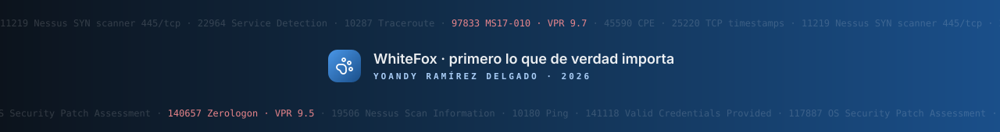
</p>
