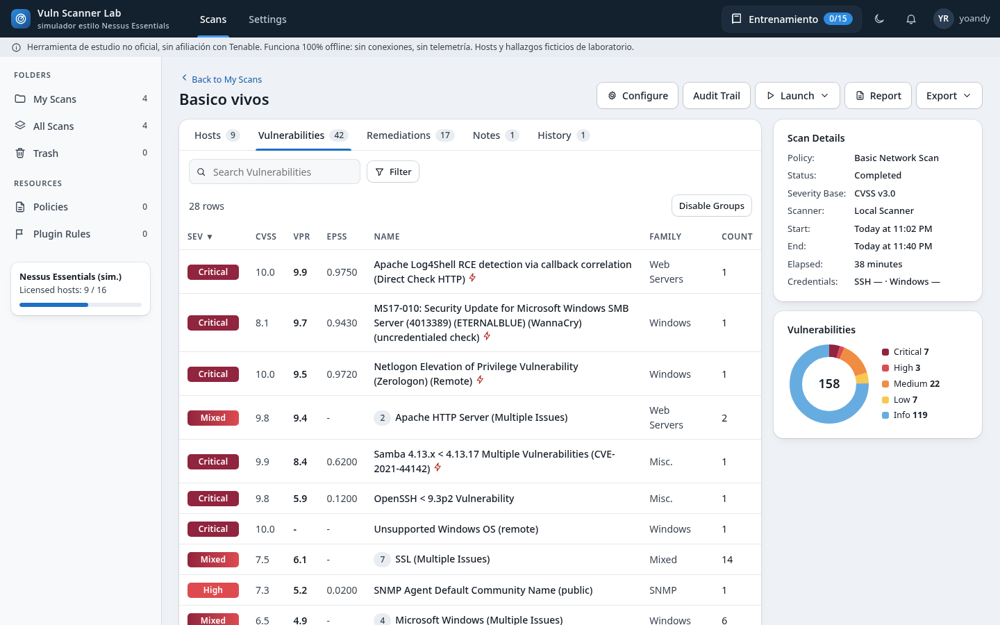
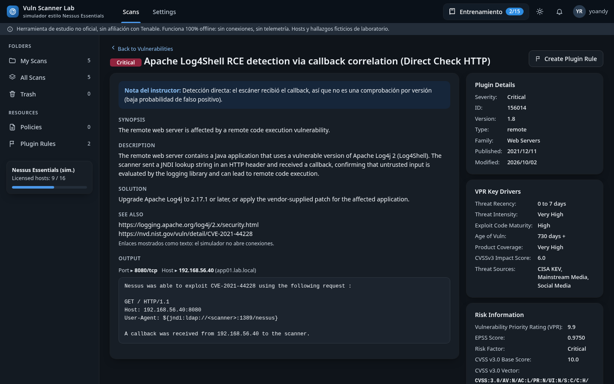
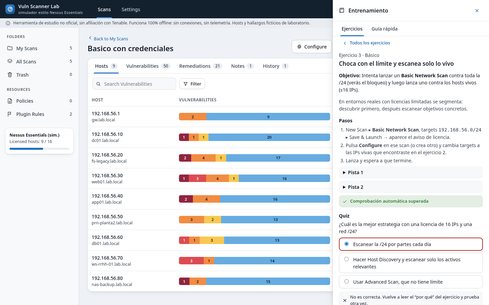

# Vuln Scanner Lab · simulador estilo Nessus Essentials

Laboratorio **privado y offline** para aprender a manejar un escáner de vulnerabilidades con el flujo y la interfaz de **Tenable Nessus Essentials**: crear escaneos, leer resultados, priorizar por CVSS/VPR, gestionar falsos positivos, aceptar riesgos y generar informes.

> **Aviso:** herramienta de estudio **no oficial**, sin afiliación con Tenable. *Nessus* y *Tenable* son marcas de sus propietarios. No contiene código, logotipos ni contenido de Tenable: la interfaz está recreada a partir de la documentación pública. Hosts, hallazgos, IDs de plugin y puntuaciones son **ficticios o representativos** con fines formativos (los CVE citados son públicos y reales).

## Cómo usarlo

1. Descarga `index.html`.
2. Ábrelo con doble clic en Chrome, Edge o Firefox. No necesita servidor ni Internet.
3. Pulsa **Entrenamiento** (arriba a la derecha) y empieza por el ejercicio 1.

- Sin conexiones externas, sin CDNs, sin telemetría. Incluye una Content-Security-Policy que bloquea cualquier petición de red.
- El progreso se guarda solo en tu navegador (`localStorage`). Para empezar de cero: **Settings ▸ Simulador ▸ Restablecer laboratorio**.
- Los informes (HTML, CSV y `.nessus`) se generan y descargan localmente.
- Tema claro y oscuro (icono luna/sol).

## Qué incluye

**Interfaz con las etiquetas reales en inglés:** Scans · My Scans / All Scans / Trash · Policies · Plugin Rules · Settings (About, Advanced, Proxy Server, SMTP Server, Custom CA, Password Mgmt, My Account).

- **Plantillas:** Host Discovery, Basic Network Scan, Advanced Scan, Web Application Tests y Credentialed Patch Audit. Las de Compliance aparecen bloqueadas, igual que en Essentials.
- **Asistente New Scan:**
  - BASIC: General (Name, Description, Targets, Upload Targets), Schedule y Notifications.
  - DISCOVERY y ASSESSMENT, con la opción de precisión (accuracy) en Advanced.
  - REPORT y ADVANCED.
  - **Credentials:** SSH y Windows.
  - **Plugins:** familias de plugins (solo en Advanced).
- **Licencia Essentials:** límite de 16 IPs. Host Discovery no consume licencia.
- **Ejecución simulada:** barra de progreso y opciones Launch (Default / Custom Targets), Pause, Resume y Stop.
- **Resultados:**
  - Pestañas Hosts, Vulnerabilities (agrupadas o no, ordenables por Sev, CVSS, VPR, EPSS, Name, Family y Count), Remediations, Notes y History.
  - Panel Scan Details con gráfico de severidades.
- **Detalle de plugin:** Synopsis, Description, Solution, See Also y Output por host y puerto. También Plugin Details, VPR Key Drivers, Risk Information (VPR, EPSS, CVSS v3.0 y vector), Vulnerability Information (Exploit Available) y Reference Information (CVE, MSKB). Incluye una nota del instructor en español.
- **Filtros:** Severity, Plugin Family, Plugin ID, Plugin Name, CVE, VPR Score, CVSS, Exploit Available y Host, con Match All o Any, además de búsqueda.
- **Audit Trail:** explica por qué un plugin no se reportó en un host (falta de credenciales, backport, puertos no escaneados…).
- **Plugin Rules:** recast de severidad, Hide this result y fecha de caducidad. Se aplican a la vista y a los informes, pero no al `.nessus`.
- **Report / Export:** Executive Summary, Detailed by Host y Detailed by Plugin en HTML, más CSV y `.nessus`.

**Red de laboratorio `192.168.56.0/24`:** 9 hosts ficticios (DC Windows 2019, servidor Windows 2008 R2, Apache, app con Log4j, impresora, CentOS con Redis, puesto Windows 10 y NAS Samba). Hallazgos como MS17-010, Zerologon, Log4Shell, Apache path traversal, Samba vfs_fruit, cifrado SSL/TLS débil, SMB signing not required, SNMP public, OpenSSH por banner (falso positivo por backport) y parches que solo se ven con credenciales.

Credenciales del laboratorio (ficticias): SSH `auditor` / `Lab2026!` · Windows `LAB\svc_nessus` / `Lab2026!`.

## Ejercicios (15, con comprobación automática y quiz)

| # | Nivel | Ejercicio |
|---|-------|-----------|
| 1 | Básico | Conoce la consola y tu licencia |
| 2 | Básico | Descubre la red con Host Discovery |
| 3 | Básico | Choca con el límite y escanea solo lo vivo |
| 4 | Básico | Lee un hallazgo crítico: MS17-010 |
| 5 | Intermedio | Filtra: críticos con exploit público |
| 6 | Intermedio | Vista Hosts: identifica el activo más débil |
| 7 | Intermedio | CVSS vs VPR: prioriza por amenaza real |
| 8 | Intermedio | Escaneo con credenciales |
| 9 | Intermedio | ¿Qué ves con credenciales que antes no veías? |
| 10 | Avanzado | Gestiona un falso positivo |
| 11 | Avanzado | Aceptación temporal de riesgo |
| 12 | Avanzado | Remediations: máximo impacto con mínimo esfuerzo |
| 13 | Avanzado | Policy reutilizable y escaneo programado |
| 14 | Gestión de riesgo | Informe ejecutivo para dirección |
| 15 | Gestión de riesgo | Plan de remediación priorizado (CSV) |

Cada ejercicio trae objetivo, por qué importa, pasos, pistas, comprobación automática en el simulador y un quiz. Hay también una **Guía rápida** con severidades, CVSS, VPR, EPSS, remote frente a local, Plugin Rules y el flujo de gestión de vulnerabilidades.

## Capturas

## Limitaciones

- Es una simulación: no escanea redes reales y no hay feed de plugins. Las puntuaciones VPR y EPSS son estáticas y representativas.
- La exportación a PDF no está disponible offline (usa HTML e imprime a PDF desde el navegador).
- La programación (Schedule) se guarda pero no lanza escaneos automáticamente.
