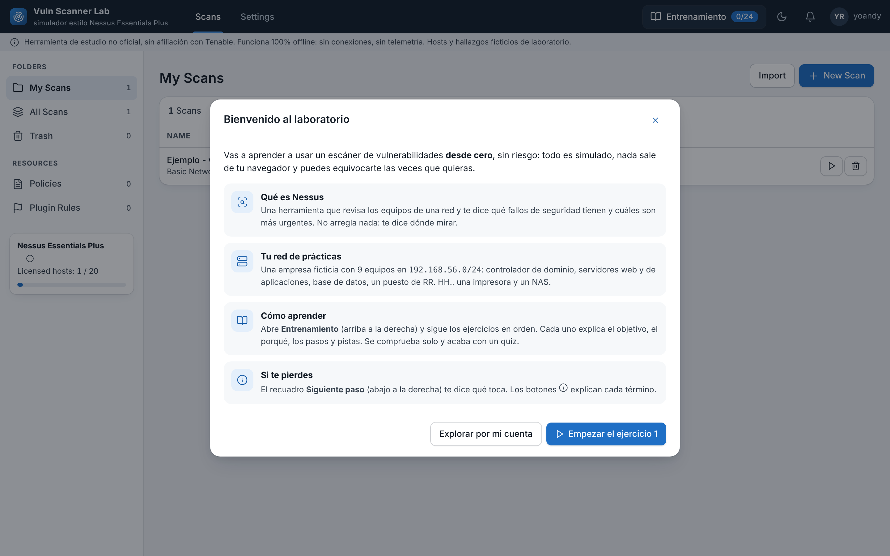
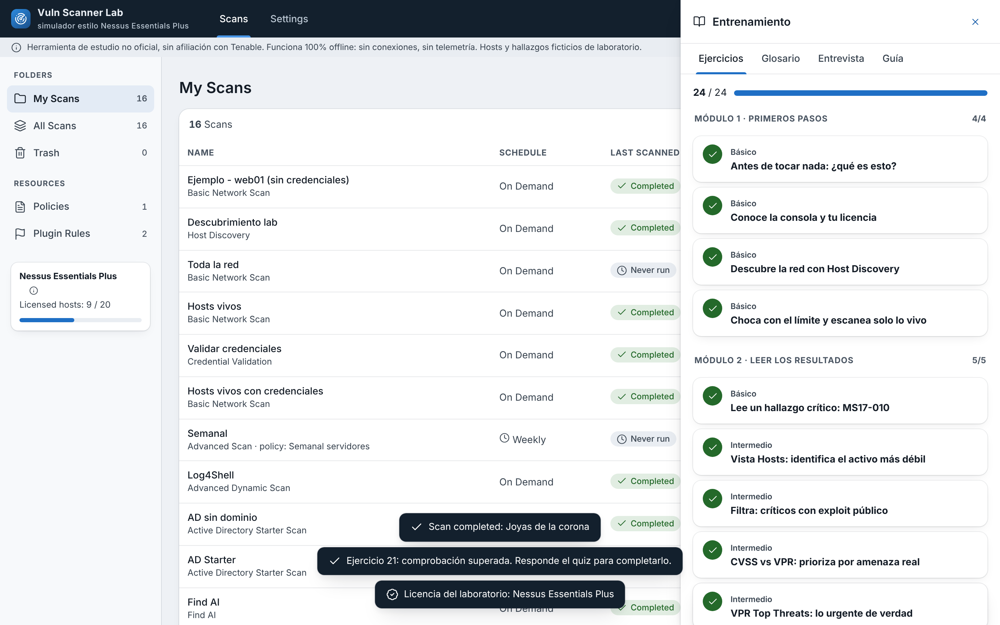
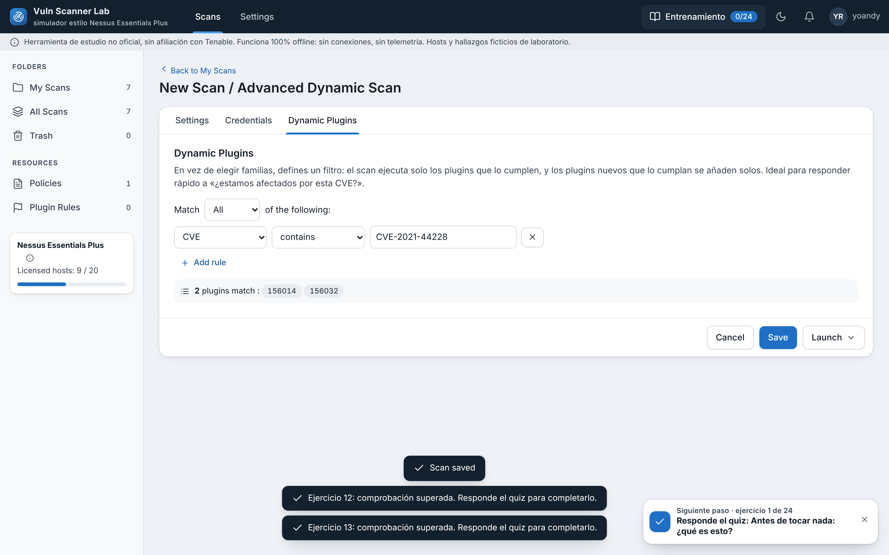
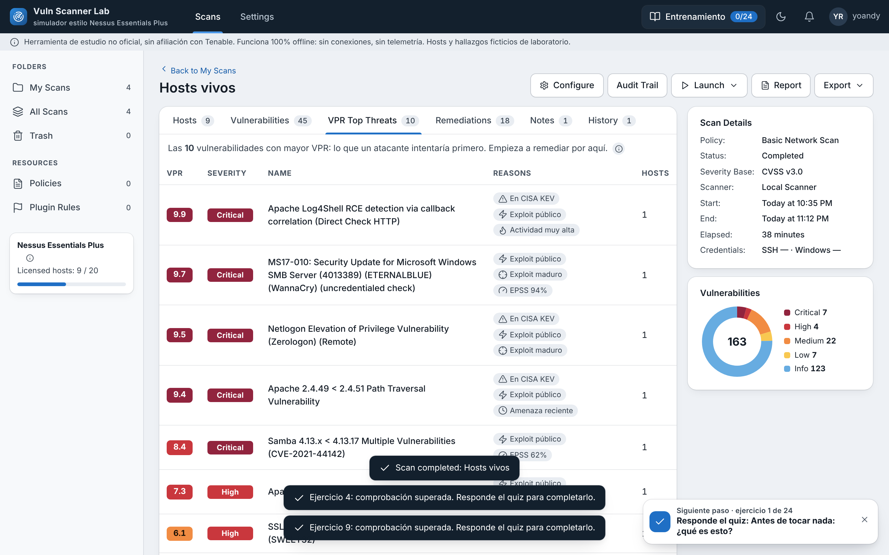
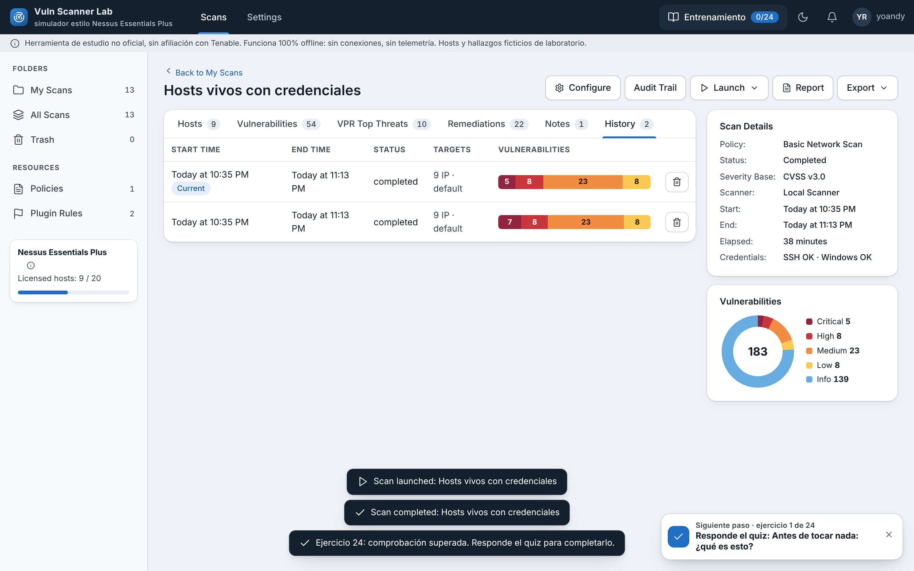
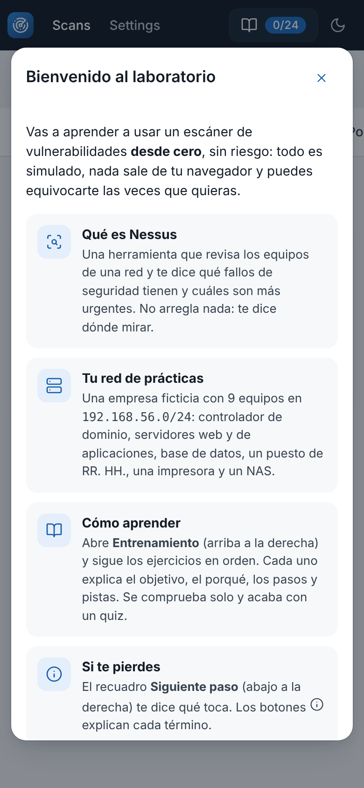

# Vuln Scanner Lab · simulador estilo Nessus Essentials Plus

Laboratorio privado y offline para aprender a usar un escáner de vulnerabilidades desde cero. Reproduce el flujo y la interfaz de Tenable Nessus Essentials Plus 10.x: crear scans, leer resultados, priorizar con VPR, validar credenciales, gestionar falsos positivos, aceptar riesgos, verificar la remediación e informar a dirección.

Está pensado para alguien que no ha abierto Nessus nunca y va a trabajar en gestión de riesgos. Cada pantalla explica qué es lo que ves y para qué sirve.

> **Aviso:** herramienta de estudio no oficial, sin relación con Tenable. *Nessus* y *Tenable* son marcas de sus propietarios. No incluye código, logotipos ni textos de Tenable. La interfaz se ha recreado a partir de la documentación pública. Los hosts y los hallazgos son ficticios. Los CVE citados son reales y públicos.

## Cómo empezar

1. Descarga `index.html`.
2. Ábrelo con doble clic en Chrome, Edge o Firefox. No necesita servidor ni conexión a Internet.
3. La primera vez se abre una bienvenida. Pulsa **Empezar el ejercicio 1**.
4. Si te pierdes, el recuadro **Siguiente paso** (abajo a la derecha) indica qué toca hacer. Los botones ⓘ explican cada término.

- No hace peticiones de red, no usa CDN y no tiene telemetría. Una Content-Security-Policy bloquea cualquier conexión.
- El progreso se guarda solo en tu navegador (`localStorage`). Para empezar de cero: **Settings ▸ Simulador ▸ Restablecer laboratorio**.
- Los informes y las exportaciones se generan en tu equipo.



## Ruta de aprendizaje: 24 ejercicios en 5 módulos

Cada ejercicio indica el objetivo, por qué importa, los pasos y las pistas. Se comprueba solo cuando lo haces en el simulador y termina con un quiz.

| Módulo | Ejercicios |
|---|---|
| **1 · Primeros pasos** | Qué es un escáner · Consola y licencia · Host Discovery · Límite de licencia |
| **2 · Leer los resultados** | MS17-010 · Vista Hosts · Filtros · CVSS frente a VPR · VPR Top Threats |
| **3 · Escanear mejor** | Credential Validation · Scan con credenciales · Lo que solo se ve con credenciales · Policies y Schedule |
| **4 · Plantillas especializadas** | «¿Nos afecta esta CVE?» con Advanced Dynamic Scan · Active Directory Starter · Shadow IT (Find AI y RMM) · Malware Scan |
| **5 · Gestión del riesgo** | Falso positivo · Aceptación temporal de riesgo · Remediations · 5 IPs: qué escanear primero · Informe ejecutivo · Plan en CSV · Remediar y verificar en History |

El panel **Entrenamiento** tiene además:

- **Glosario:** 20 términos explicados para principiantes (vulnerabilidad, plugin, CVSS, VPR, EPSS, KEV, falso positivo, SLA, riesgo…).
- **Entrevista:** 12 preguntas habituales en una entrevista o en la primera semana de un Risk Manager, con respuesta modelo.
- **Guía:** severidades, métricas y el ciclo de gestión de vulnerabilidades.



## Qué reproduce de Nessus

**Licencia.** Se puede elegir entre los dos niveles gratuitos en **Settings ▸ About**:

| | Essentials | Essentials Plus (por defecto) |
|---|---|---|
| Hosts que se pueden escanear | 5 | 20 |
| Informes HTML y PDF | No (solo CSV y `.nessus`) | Sí |
| Actualización de plugins | Diaria | En tiempo real |

La licencia cuenta hosts distintos escaneados, no scans. Host Discovery y Ping-Only Discovery no consumen licencia.

**Plantillas (10.x).**
- Discovery: Host Discovery y Ping-Only Discovery.
- Vulnerabilities: Basic Network Scan, Credential Validation, Advanced Scan, Advanced Dynamic Scan, Malware Scan, Credentialed Patch Audit, Active Directory Starter Scan, Find AI y Remote Monitoring and Management.
- Bloqueadas, con la versión que las incluye: Compliance (Professional o Manager), Web Application (Expert), Attack Surface Discovery (Expert) y Mobile Device Scan (Manager).


**Editor de scan.**
- BASIC: General, Schedule y Notifications.
- DISCOVERY, ASSESSMENT (accuracy y malware en Advanced), REPORT y ADVANCED.
- Credentials: SSH y Windows. AD Starter necesita también el dominio.
- Plugins: familias, solo en Advanced Scan.
- Dynamic Plugins: reglas por CVE, Plugin ID, nombre, familia o severidad, con recuento en vivo de los plugins que coinciden.



**Resultados.**
- Pestañas Hosts, Vulnerabilities, **VPR Top Threats**, Remediations, Notes e History.
- VPR Top Threats muestra los 10 hallazgos con más VPR y sus motivos: KEV, exploit público, actividad o EPSS.
- History incluye la barra de severidades de cada ejecución, para comparar antes y después de remediar.
- Detalle de plugin: Synopsis, Description, Solution, Output, Plugin Details, VPR Key Drivers, Risk Information y Reference Information. Incluye una nota del instructor en español.
- Filtros (Match All o Any), Audit Trail y Plugin Rules (recast, Hide this result y caducidad).
- Report: Executive Summary, Detailed by Host y Detailed by Plugin, en HTML, PDF (con el diálogo de impresión del navegador) y CSV.
- Export: `.nessus`, CSV y Nessus DB. En el laboratorio, Nessus DB se cifra de verdad con AES-256-GCM y una clave derivada con PBKDF2.



**Ayuda propia del laboratorio (no existe en Nessus).** El botón **Simular parche** de Remediations marca una acción como aplicada. Al volver a lanzar el scan, el hallazgo desaparece y en History se ve el cambio. Sirve para practicar el ciclo completo: remediar y verificar.



## Red de laboratorio `192.168.56.0/24`

| IP | Host | Lo que vas a encontrar |
|---|---|---|
| .1 | gw (pfSense) | Certificados TLS |
| .10 | dc01, Windows Server 2019 | Zerologon; con AD Starter: Kerberoasting, delegación sin restricciones, KRBTGT antigua, AS-REP roasting |
| .20 | fs-legacy, Windows 2008 R2 | MS17-010, sistema sin soporte, TeamViewer |
| .30 | web01, Apache 2.4.49 | Path traversal; OpenSSH por banner (falso positivo por backport) |
| .40 | app01, Java | Log4Shell; API de Ollama abierta sin autenticación |
| .50 | Impresora | SNMP `public`, Telnet |
| .60 | db01, CentOS 7 | Redis sin autenticación en un puerto no estándar |
| .70 | ws-rrhh-01, Windows 10 | Parches y Chrome (solo con credenciales); AnyDesk no aprobado; malware |
| .80 | NAS Samba | Samba vfs_fruit, FTP anónimo |

Credenciales del laboratorio (ficticias): SSH `auditor` / `Lab2026!` · Windows `LAB\svc_nessus` / `Lab2026!`, dominio `LAB`.

Los plugins con ID 900000 o superior son inventados para practicar las plantillas de AD, malware, IA y acceso remoto. El resto de IDs son reales; los textos y las puntuaciones son representativos.

## Diseño

- Iconos [Lucide](https://lucide.dev) (ISC), copiados en línea sin CDN.
- Movimiento basado en los criterios de Emil Kowalski: curvas `ease-out`, duraciones entre 150 y 320 ms, respuesta al pulsar con escala 0,97, menús que crecen desde su botón, avisos que entran y salen sin saltos. Con «reducir movimiento» solo hay fundidos.
- Tema claro y oscuro. Funciona en el móvil (390 px) sin desplazamiento horizontal.
- WCAG 2.2 AA: axe-core sin infracciones en claro, en oscuro, a 1440 px y a 390 px.


<p> </p>

## Pruebas

`pruebas/e2e.js` abre el laboratorio en Chromium y hace un recorrido completo:

- Completa los 24 ejercicios usando la aplicación.
- Comprueba los límites de las dos licencias, el scan dinámico, AD sin dominio, el ciclo de parche y verificación, y las descargas (incluido que Nessus DB no deja IPs en claro).
- Pasa axe-core 21 veces: 16 pantallas en escritorio y 5 en móvil, en claro y en oscuro.
- Falla si hay errores de consola o alguna petición fuera de `file:`.

```bash
cd pruebas
npm install
npx playwright install chromium   # si no lo tienes
npm test                          # 55 comprobaciones
```

## Limitaciones

- Es una simulación: no escanea redes reales y no descarga plugins. VPR y EPSS son valores fijos.
- La programación (Schedule) se guarda, pero no lanza scans sola.
- Import de archivos `.nessus` no está disponible.
